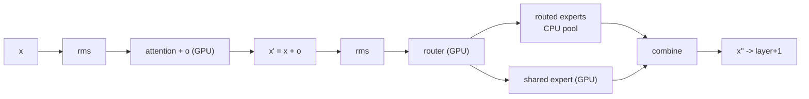

# Kolibri-1 decode on the R9700: where the time goes, and what can move

Measured on card0 only, Ryzen 7 5700G (8 cores), 93 GiB, Radeon AI PRO R9700 32 GB, ROCm 7.2.2,
engine 0.1.52, `Kolibri-1-Q4_K_M.gguf` (50 layers, 384 experts, top-6, 42.90 GiB pinned).
Unless stated otherwise: ctx 8192, a 512-token prompt, `--cpu-threads 8`, the shipped default path.

This is the decode companion to [KOLIBRI_P4_SHIPPING.md](KOLIBRI_P4_SHIPPING.md). P4 changed the prompt
read and left decode untouched; this file is about decode.

## The measurement that frames everything

`rocprofv3 --kernel-trace` over 17 decode tokens, one steady token taken from the end:

| | per token | share |
|---|---|---|
| wall | **67.4 ms = 14.7 tok/s** | |
| GPU busy (sum of kernel time) | 24.3 ms | 36 % |
| **50 host round trips, one per layer** (~550 µs each) | **25.4 ms** | **38 %** |
| dispatch gaps, 1 343 × median 11.7 µs | 17.7 ms | 26 % |
| kernel launches | **1 344** | |
| routed-expert bytes through the CPU pool | **714.2 MB at 32.4 GB/s** | |

Every one of the 50 large gaps begins immediately after a `copyBuffer` and ends at the next
`quantize_q8_1`: the GPU has finished a layer, has handed that layer's expert rows to the host, and is
waiting while the CPU pool computes those six experts. The engine's own counters agree — `CNT pool
phases: ... drain 22.33 ms/tok` against 22.18 ms of pool work, i.e. the pool is never idle-waiting; it is
computing, and the GPU is doing nothing beside it.

GPU busy, by kernel, same token:

| kernel | launches | ms/token | share of GPU busy |
|---|---|---|---|
| `k_attn` (attention) | 50 | **10.57** | 43.5 % |

Read that 43.5 % as a share of *GPU busy*, not of the token: attention is **16 % of the token**
(10.57 of 67.4 ms). Zeroing it entirely would take 15.9 → 18.1 tok/s. The host leg and the dispatch are
the token.
| dense + shared-expert `mmvq` | 351 | 7.31 | 30.1 % |
| `k_rms` + `k_rms_add` | 201 | 3.54 | 14.6 % |
| `quantize_q8_1` | 351 | 0.92 | 3.8 % |
| router (`k_gemv_f32_v4` + `route_sigmoid_logit_add`) | 100 | 0.84 | 3.5 % |
| `copyBuffer` + rest | 291 | 1.11 | 4.5 % |

An unprofiled run of the same shape measured by the engine's own counters earlier in this campaign was
**62.9 ms (15.90 tok/s), GPU busy 16.1 ms, pool 22.3 ms** at ctx 131072
([KOLIBRI1.md](KOLIBRI1.md#where-the-speed-goes-and-what-is-left-measured-2026-10-28-on-the-same-r9700)).
The two agree on the shape; treat GPU busy as 16-24 ms and the host leg as 22 ms.

## The host leg is at its hardware ceiling

`pool_bench` on this box, cold blobs, six experts per call:

| workers | GB/s | ms/token |
|---|---|---|
| 1 | 27.1 | 24.5 |
| **6** | **32.3** | **20.6** |
| 12 | 30.6 | 21.7 |
| 24 | 16.4 | 40.5 |
| 48 | 7.7 | 86.5 |

The engine already runs at 32.4 GB/s. 714 MB/token at 32.3 GB/s is **22.1 ms**, so the pool leg cannot be
tuned further on this CPU. Raising `--cpu-threads` past 8 makes decode worse, as the table predicts.

## The dependency that forbids the obvious overlap

Decode is a strict chain, one layer at a time:



Layer L+1 cannot start before layer L's combine, because its attention input is `x''`. So the 22 ms of
host expert work **cannot hide behind the GPU's own work**, and a "pipeline the layers" change is not
available for a single token. The prefill's existing overlap (`STRATA_KOLIBRI_PF_PIPE`, "A2b: THE
OVERLAP") works only because two *chunks* are genuinely independent of each other.

The one independent pair inside a layer is the shared expert and the routed experts. Overlapping them is
worth at most ~1.0 ms/token, because the shared expert is one of the seven `mmvq` products per layer.

Two ways to get real overlap remain, and both need more than one sequence or more than one token in
flight: **concurrent requests** (serve throughput, not single-stream latency) and **batched verify**
(speculative decoding, [trajectory E](#e-drafter-free-speculation-orthogonal)).

## How the Flash-Next engine gets its decode speed

From `src/qwen35/q36_engine.cu`:

1. **The whole token is one captured graph** (`graph_run`, `forward(1, pos, 1, use_graph, false)`), with
   the position in a device scalar. One host launch per token instead of ~1 300.
2. **Every routed expert lives in VRAM, and VRAM is reallocated to make them fit**: it gives back the
   packed Q8_0 copies, shrinks the attention score buffer 256 → 64 MB and the reserve 768 → 256 MiB,
   and sets `n_slots = ne`.
3. **`route_group()` fuses router + top-k + grouping** in one launch, and the shared expert's gate rides
   as an extra row of the router matrix (`router_ext`, `n_expert + 1` rows).
4. **One grouped expert launch per layer**, blobs repacked at load as `[gate | up | down]`.
5. **`native_swiglu_quantize_q8_1`**: SwiGLU and its q8_1 image in one launch.
6. **Decode attention is split-K** (`k_attn_part` over 256-cell chunks + `k_attn_merge` with LSE).
7. **The hybrid mode is named as a slowdown**: `if (main_hybrid) use_graph = false; // the host takes
   part in every layer`.

Point 7 is the whole difference. Kolibri's 42.90 GiB of experts cannot fit in 32 GB, so the host takes
part in every layer, so the graph is illegal, so the token pays 1 344 launches and 50 round trips. The
R9700 is idle for two thirds of the token: **its extra compute over a T4 is not being used at all.**

## What has already been tried on this box, and lost

| arm | bytes/token | pool leg | decode | why it lost |
|---|---|---|---|---|
| shipped (pool) | 714.2 MB | 22.04 ms | **67.4 ms** | — |
| `--grouped` | 331.8 MB | 10.46 ms | 65.9 ms¹ | the 25 grouped layers read their blobs from the pinned table **over PCIe (5.7-6.1 GB/s)**, not from VRAM |
| `--expert-slots auto --expert-slots-hot` | 222.7 MB | 7.25 ms | 42.6 ms¹ | 253 slots/layer fit, but the slot path costs **3 launches per pick** |
| `--cpu-threads 24` | — | — | 7.6 tok/s | oversubscribes 8 physical cores |
| K stored transposed (coalesced score dot) | — | — | 1.01x on the score pass | measured, see below |
| wall-difference from `--n 1` vs `--n 65` | — | — | (24.0)² | page-cache variance in the 45 GB load, not a real result |

¹ measured over a 512-token prompt by the same difference method, so the *comparison* is valid even
though the absolute figure carries load variance. ² retracted; the trace and the counters agree at ~15.

**Cutting bytes on the host does not help** — both byte-cutting arms are slower, because neither removes
the per-layer hand-off and both add launch or PCIe cost.

### The attention layout question is closed

`src/kolibri/attn_k_parity.cu` (built by hand as HIP for this run, since its CMake target is CUDA-gated)
proves the transposed K layout is **bitwise identical** to row-major in all 7 synthetic shapes, and prices
both at the short-decode geometry (H = 48 blocks, 256 threads, sw 513, pos 1000):

| layout | score pass | effective rate |
|---|---|---|
| row-major (shipped) | 0.0605 ms | 104.2 GB/s |
| transposed (bitwise) | 0.0601 ms | 104.9 GB/s (**1.01x**) |

So the coalescing fix is safe but worthless *on this card*, and the score dot is only 0.06 ms of the
0.211 ms per-layer attention: 28 %, not the 91 % the T4 ledger recorded. What is left is the softmax and
the PV pass, which re-read K/V per head instead of tiling them once per KV head. That is the shape a
split-K + GQA-tiled decode attention would fix, and it is bounded by attention's 16 % of the token.

## Trajectories

**The ranking changed once the attention layout was measured.** Three facts decide it:

- The host leg is **38 %** of the token and the dispatch gaps **26 %**; attention is **16 %**.
- The host leg cannot be overlapped within a token (the dependency above) and is at its hardware ceiling.
- A whole-token graph is illegal while the host is in every layer, so B is a *precondition* of C, not an
alternative to it.

So: **B → C is the road, D rides along, E is orthogonal.** B alone is ~1.2x; C is the class change.

| step | token | tok/s | numerics |
|---|---|---|---|
| today | 67.4 ms | 14.7 | — |
| **B** per-layer graphs | ~52 ms | **~19** | none |
| **B + D** | ~45 ms | ~22 | D needs a KL gate |
| **B + C** | ~33 ms | **~30** | C moves ids |
| **B + C + D** | ~26 ms | **~38** | |

### B. Per-layer graph segments (the 17.7 ms of dispatch) — **first**

The GPU-only part of a layer (attention → dense → router) contains no host call and is capturable; the
pool drain splits the layer, so the region after it is a second capture. Two graphs per layer, 100 host
launches instead of ~950. `--grouped` already captures per-layer graphs, so the mechanism exists.

One prerequisite, and it is the real work: **a captured graph's kernel arguments are frozen**, so the
current position cannot stay a host value (`s.pos` is passed to `k_attn`, the KV store and the merge). It
must become a device scalar, exactly as the Flash-Next engine keeps `d_delta` and as this engine already
keeps `s.toks_d` for `PF_PIPE`. Expected: 17.7 → ~4 ms. Effort: medium. Numerics: none, if the kernels and
their order are unchanged — and that is testable, because a frozen graph either produces the same ids or it
does not.

### C. Move the expert bytes to VRAM — the Flash-Next recipe, adapted

The only thing that removes the 22 ms host tax. Two sub-steps, in this order:

- **C1, grouped decode from VRAM slots.** Replace the 3-launches-per-pick slot path with the grouped
  kernel the prefill already uses (`native_expert_grouped` takes a per-group pointer array, so a table
  that mixes VRAM slots and the pinned host table needs no new kernel — it needs the slot map and the
  group build on the device, as `k_group` already does for prefill). 253 slots/layer fit (measured by the
  engine's own fitter), and 214 slots already served **96.6 %** of picks. Misses then cost
  0.034 × 714 MB = 24 MB over PCIe ≈ 4 ms.
- **C2, the whole-token graph.** Legal only once no host call remains inside the token.

Expected: C1 ~45-50 ms, C1+C2 (with B) ~30 ms, and with D ~26 ms → 30-38 tok/s. Effort: large.
Numerics: changes ids — residency moves bytes between stores (measured 0.855 mean |Δlogit|, id flips).

**Structural ceiling without C: about 28 tok/s.** Even with zero dispatch gaps and free attention, the
token still pays the serial 22 ms host leg plus real GPU work. Only C breaks that.

### D. Decode attention: bounded, do it after C

`k_attn` is 43.5 % of GPU busy but **16 % of the token**: 10.57 ms/token at 513 visible positions, geometry
H = 48, HKV = 4, D = 128, one block per head, 128 threads. Its score pass already runs at 104 GB/s and the
layout fix measures 1.01x, so the remaining cost is the softmax and PV re-reading K/V 12 times (the GQA
ratio) instead of tiling them once per KV head the way `k_attn_flash` does in prefill.

Expected: **+2 tok/s** at short context (67.4 → ~60 ms), more at 100K, where attention is the wall.
Effort: medium (fused, split-K, GQA-tiled). Numerics: the fused/split forms change the sum order, so it
needs its own KL gate; the bitwise route (transposed layout) is refuted on speed.

### E. Drafter-free speculation (orthogonal)

`src/ngram` and `src/spec` exist, and Flash-Next already runs MTP/verify. Without a drafter, prompt-lookup
/ n-gram proposals are the option. Note the MoE arithmetic: verifying T rows touches roughly T× more
distinct experts out of 384 top-6, so **bytes per accepted token barely improve** (4 rows ≈ 3.3× the
bytes ≈ 0.83× per token). What amortizes well is the *structure*: one round trip and one grouped launch
serve T rows, so the 25.4 ms of host gaps and most of the dispatch divide by the batch size. Acceptance
on free text is the open question; on code and quoted spans it is much higher.

## Open questions this measurement cannot settle

- **Why the T4 box measured 30.3 tok/s where this box measures 14.7-15.9.** Its host streams at
  43.4 GB/s against 32.4 here, which explains only ~5.5 ms of the difference; plugging that in gives
  ~17 tok/s, not 30. Candidates: attention behaviour at the T4's geometry, or a different harness window
  (here, tokens 2-129 run 21.3 tok/s against 15.8 steady). Needs the T4 arm re-measured on the same
  harness, and is not claimed.
- **Whether `k_attn_flash` at decode geometry is numerically identical or merely close.** It changes ids
  in prefill, so assume it changes them here and gate it as a numerical arm.
- **The real hit rate at 253 slots on this card.** 96.6 % was measured at 214 slots on this box, and
  253/layer is what fits here; the figure for 253 with `--expert-slots-hot` has not been measured.
- **Whether a grouped decode GEMV can reach VRAM bandwidth** (640 GB/s class) or is latency-bound at
  one row. The prefill grouped kernel's shape is not the decode shape.

## Reproduce

```sh
# the trace behind every number in the first table
HIP_VISIBLE_DEVICES=0 rocprofv3 --kernel-trace --output-format csv -d /tmp/dec -o dec -- \
  ./build-mmq/strata-kolibri --model /fast/models/Kolibri-1-Q4_K_M/Kolibri-1-Q4_K_M.gguf \
  --tokens-file tools/kolibri/oracle_ids512.txt --n 17 --ctx 8192 --cpu-threads 8

# the host ceiling
./build-mmq/pool_bench
```

Two cautions for anyone repeating this: `--dump-logits` writes only the top-two records, so bit-equality
claims need `--dump-full-logits`; and a wall difference between two `--n` values is dominated by the
45 GB model load unless the page cache is warm — use the trace's per-token timestamps instead.
