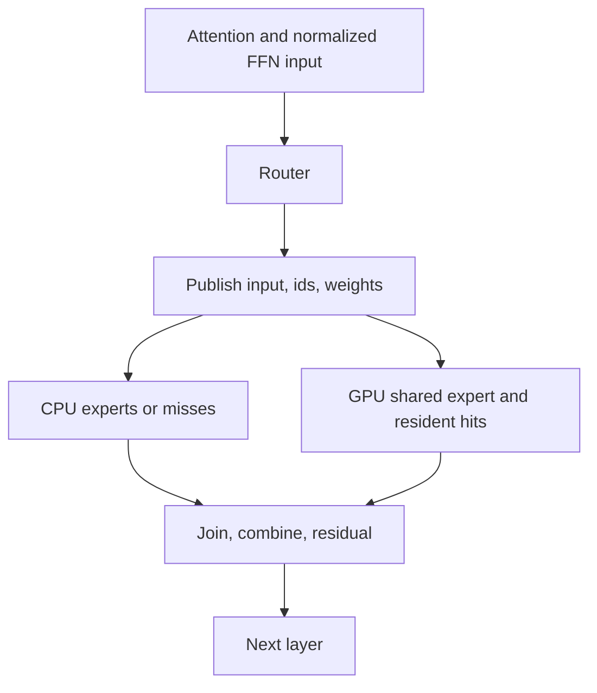

# Kolibri-1 decode on the R9700: reassessed investigation

This supersedes the conclusions in the first version of this document. The old raw runs remain useful,
but several interpretations were wrong. No engine change or new speed-up is claimed by this reassessment.

Scope: single-stream Kolibri decode, **no drafter**, card0 only (`HIP_VISIBLE_DEVICES=0`).
Box: Ryzen 7 5700G, 93 GiB RAM, R9700 32 GB, ROCm 7.2.2. Model: Kolibri-1-Q4_K_M.
P4 improves prefill; the next work must preserve that path and establish decode gains separately.

## Review findings

1. **The wrong Qwen engine was studied.** `src/qwen35/q36_engine.cu` is Qwen3.6-35B-A3B, not
   Qwen3.8-Flash-Next. Its all-in-VRAM recipe is not an adequate description of Flash-Next's hybrid path.
2. **CPU participation does not prohibit a whole-layer-stack graph.** Actual Flash-Next has a captured
   graph that publishes work to the CPU and waits for the CPU's answer through mapped-memory flags.
3. **The old slot comparison cannot decide a winner.** Its 42.6 ms/token and the grouped arm's 65.9 ms
   came from separate process-wall differences, including model load. Rejecting that method for the
   baseline but trusting it for the alternatives was inconsistent.
4. **The format limitation was reversed.** In this build, grouped Q6_K down is compiled in; Q4_K down
   is absent from the grouped down dispatch list. A stale Kolibri comment says the opposite.
5. **The instrument and gates were underspecified.** A trace is not an unprofiled latency measurement;
   the proposed CSV fixture was malformed and its supposed 60 ms period was actually 114 ms. Prefill
   hashes do not validate decode results. Free-running outputs cannot be used as aligned KL inputs.
6. **The 30–38 tok/s projections are withdrawn.** Neither a valid paired baseline nor the proposed
   execution path has been measured. The earlier 96.6% hit rate is not a guarantee for another prompt,
   context, slot budget, or part of a run.

## What the old measurements actually establish

These are historical observations, not new measurements from this review.

### Kernel trace: diagnostic, not a performance baseline

Artifact: `/tmp/kolibri-dec/trace/dec_kernel_trace.csv`. Invocation: plain prompt processing,
512 prompt ids, 17 generated tokens, ctx 8192, eight CPU threads, card0, kernel tracing enabled.
The file has 528 embedding-gather markers: 511 plain-prompt forwards plus 17 generation forwards — the
counts `tools/kolibri/decode_bench.py --trace` requires callers to declare before it will attribute
anything to decode. The last complete generation interval contains 1,344 dispatches.

Reproduced by `parse_trace(..., prompt_forwards=511, generation_forwards=17)` on 2026-10-29, per token:

| Observation in the traced decode window (17 tokens) | Per token |
|---|---:|
| Marker-to-marker window | 67.9 ms |
| Interval union of kernel durations | 24.2 ms |
| Attention kernels | 10.5 ms |
| Gaps longer than 100 µs | 51; 26.0 ms |
| Remaining inter-kernel gaps | about 17.7 ms |

A marker-to-marker window excludes the final host sampling interval; neither statistic should be
relabelled as unprofiled end-to-end latency. Report interval-union time as **kernel execution
coverage**, not general GPU utilization: a kernel-only trace does not include every copy-engine
transfer or explain every uncovered interval.

The 51 large gaps are consistent with the source's per-layer CPU work. They are not a measurement of
26.0 ms of removable driver overhead: most of that gap can be necessary expert computation. The other
17.7 ms is not proven to be entirely launch overhead either. HIP API correlation and unprofiled runs
are needed before assigning a cause or a speed-up budget. Profiling itself can perturb these gaps,
and this traced run does not reproduce the unprofiled rate below, so its gaps cannot be subtracted
from an unprofiled measurement.

### Counters include plain-prompt processing

`/tmp/kolibri-dec/base-65.err` reports `tok=576`: **511 prompt forwards + 65 generation forwards**.
Its 714.2 MB/token and 22.04 ms/token pool work are averages over both phases, not isolated decode.
The corresponding slots log reports 72.0% aggregate hits and 222.7 MB/token CPU traffic. That also mixes
prompt and generation; it does not establish the hot cache's decode hit rate after prompt reselection.

The serve path already takes hit/miss counter snapshots before generation and reports the deltas in
`DONE`. Use those rather than an all-run cache average. See `src/kolibri/kolibri_engine.cu:4974–5031`.

### CPU benchmark: best observed rate, not a hardware impossibility proof

The earlier cold-blob `pool_bench` sweep reported 27.1 / 32.3 / 30.6 / 16.4 / 7.7 GB/s at
1 / 6 / 12 / 24 / 48 workers. It supports avoiding oversubscription. It does **not** prove that no CPU
kernel, work partition, format-specific path, or overlap can improve the current implementation.
The synthetic blob shape and the model's mixed formats must also be kept distinct.

### Attention layout: one narrow result

A manually built HIP `attn_k_parity --bench` reported 0.0605 ms row-major versus 0.0601 ms transposed,
with seven synthetic parity cases passing. This is a score-only microbenchmark with 256 threads.
The selected engine trace used 128-thread attention blocks and includes score, normalization and PV.
Subtracting the microbenchmark from that trace does not establish a 28% score fraction or locate the
remainder. It does not close attention optimization at other positions or rule out full-kernel gains.

## Measured: the unprofiled baseline and the existing overlap arm

Instrument: `tools/kolibri/decode_bench.py`, tested by `tools/kolibri/test_decode_bench.py` (46 CPU
tests, no GPU). It scores the engine's own `DONE` `decode_ms` — which starts after the prompt has been
consumed — and reports the `T`-to-`T` interval medians beside it. A candidate arm must print a marker
that the baseline run must not print, so an arm that is switched on but inert fails instead of being
scored. Every run is a fresh engine process, and the arms alternate order across pairs.

Configuration for every run below, card0 only (`HIP_VISIBLE_DEVICES=0`):

| Item | Value |
|---|---|
| Engine | `build-mmq/strata-kolibri`, sha256 `5a4b5766…26f0cd` |
| Model | `Kolibri-1-Q4_K_M.gguf`, 47,454,113,472 B |
| Flags | `--serve --prefill --cpu-threads 8`, no expert slots (`slots=0`, all 50 layers pool) |
| Prompt path | P4 MMQ active, `STRATA_HIPBLASLT_TUNING=tools/hip/gfx1201-hipblaslt-100202.txt` |
| Prompt chunk | 256 (the `pf_chunk_at` rule for a prefix below 8192 tokens) |
| New tokens | 96 per request |
| Workloads | 512 ids, ctx 8192 · 8191 ids, ctx 12288 |
| Load average before the runs | 3.0–5.3 (1 min) |

96 rather than 128 new tokens because the 512-id prompt's greedy continuation reaches end-of-sequence
at token 117 on this prompt path; a shorter-than-requested request is refused by the harness, not
scored. The 8191-id prompt is `docs/DETAILS.md` tokenized by `tools/kolibri/make_decode_ids.py` into
`tools/kolibri/decode_ids8191.txt`, so the long case has the KV length and a mixed routing pattern
rather than one 512-id block tiled 16 times.

### Noise floor: six runs of one configuration

Both arms ran the identical configuration; the "candidate" arm differed only by being launched second.

| Short workload, 96 tokens | Per token |
|---|---:|
| Six runs | 62.10, 62.13, 62.13, 62.14, 62.20, 62.35 ms |
| Median | 62.14 ms (16.10 tok/s) |
| Spread | 0.25 ms (0.4 %) |

A 0.4 % spread is the resolution this box gives a single short run. An earlier four-run set contained
one 99.7 ms/token outlier with the same configuration and no load difference we could identify; it did
not recur in these six. That is why the arm comparison below uses alternating pairs and medians rather
than one run per arm.

### `STRATA_KOLIBRI_DEC_XEXP`: the existing overlap arm

The arm enqueues the layer's shared expert before the CPU pool drain. Same kernels, same stream, same
arithmetic — only the enqueue point moves, so it is bitwise by construction rather than by measurement.
`--require-marker "DEC_XEXP active"` proved it live: the marker appeared in all six candidate logs and
in none of the six baseline logs.

| Workload | Baseline median | Candidate median | Change |
|---|---:|---:|---:|
| 512 ids, ctx 8192 | 62.10 ms (16.10 tok/s) | 58.86 ms (16.99 tok/s) | **−5.2 %** |
| 8191 ids, ctx 12288 | 85.42 ms (11.71 tok/s) | 81.86 ms (12.22 tok/s) | **−4.2 %** |

All six pairs favoured the candidate, and the `T`-to-`T` medians agree (62.44 → 59.26 ms; 86.36 →
83.21 ms). Run-to-run spread inside an arm stayed under 0.7 % on the short workload and 2.8 % on the
long one. This satisfies the revised plan's acceptance rule (all pairs favour, median reduction at
least 5 %, no workload regressing more than 2 %) for the short workload, and comes close on the long
one; it is a small gain from an arm that already existed, not a new mechanism.

Raw records, including per-run intervals, environment, load average and logs:
`/tmp/kolibri-dec2/{baseline3,xexp,xexp-long}/`.

### What this does and does not change

The shipped default is unchanged: `STRATA_KOLIBRI_DEC_XEXP` is still off unless it is set. The
scheduling work in the plan is still worth attempting, but the ceiling it can reach is now partly
measured: overlapping the shared expert with the pool drain is worth about 3.7 ms of a 62 ms token.

## Protocol proof on this box (gfx1201)

Before any model code, the plan's Task 2 asks for the per-layer publication protocol to be proven with a
payload that changes on every replay. Two tests now cover it:

| Test | What it proves | Result on card0 |
|---|---|---|
| `tests/hip/handoff.cpp` (existing) | the primitives: waits, separate copy/rings, fused publishes | PASS, 1.18 s |
| `tests/hip/kolibri_decode_handoff.cpp` (new) | the protocol: 150 layer steps over 3 tokens, bitwise | PASS, 0.50 s |

Both run under `ctest -R handoff` and under an external deadline. The new test's cases:

- **A** — 50 layers × 3 tokens through one captured publish graph and one captured answer graph, launched 150
  times. The payload encodes `(token, layer)`, so a capture-time literal cannot pass; the CPU's answer is
  copied back by `copy_from_mapped` and accumulated on the device, so a stale answer cannot pass either. All
  2 560 accumulator values match bitwise (`memcmp`, not a tolerance).
- **B** — the sequence is reset to 0 after the stream goes idle, then the same 50 layers replay identically.
  The first version of this case failed because the expected ring value kept counting across the reset; a
  reset has to restart the expectation too, which is exactly the kind of thing the arm must not get wrong.
- **C** — 30 rings, host spinning with no driver call: the ring was seen 30/30 times, and the captured graph's
  ~3 ms of independent GPU work was still running in 30/30 of them. So on this driver a mapped publication is
  visible to a pure host spin, and the host really does get to run while the GPU is busy.
- **D** — a graph with no publish node does not ring; the host's 250 ms deadline fires and the buffers are
  released only after the stream is quiesced.

**A negative control was run, not assumed**: with the pre-graph launch commented out, case A timed out at its
bounded wait and exited 12 in 5.1 s instead of hanging, and the unmodified test was restored and re-run green.

One consequence for the design: `src/core/session.cpp` records that on this driver the per-layer poll must
call the driver (`cudaEventQuery`) for the mapped write to become host-visible, and three of its experiments
broke when that call was throttled. Case C does not reproduce that requirement for `doorbell_publish` (which
carries a `__threadfence_system()` after the store on HIP). Two claims are now on record with different
results in different graphs, so the arm must measure its own loop rather than inherit either. What must not
happen is a per-layer stream sync presented as a fix; that would serialise the very overlap being bought.

## The actual Flash-Next recipe

Start with these source paths and entry points, not Qwen3.6's driver:

| Source | Mechanism and applicability |
|---|---|
| `src/program/generate.cpp:8245–8344` | Selects token capture; static-profile resident hits can be decided on-device. Capture is conditional: native-pack, multi-GPU and dump paths have different eligibility. |
| `src/program/generate.cpp:17596–17612` | Live call to `session_run_token`, otherwise `session_loop`. |
| `src/core/session.cpp:session_capture_token` | Captures all layers as publish → shared/resident work → wait → mapped result read → combine. |
| `src/core/session.cpp:session_run_token` | Launches the graph, polls each layer sequence, runs the CPU pool, publishes the acknowledgement, then waits for token completion. |
| `src/core/session.cpp:session_loop` | Alternative two-graph-per-layer path; starts GPU hit work before CPU misses, then combines this layer's outputs with this layer's routing weights. |
| `src/core/layer.cpp:moe_route`, `block_layer_pre` | Publishes normalized input, ids and weights before shared-expert work (`g_shared_early` defaults true). |
| `src/kernels/cuda/elementwise.cu` | `doorbell_publish`, `doorbell_ring`, `doorbell_wait`, `copy_from_mapped`; explicit system fences and HIP visibility provisions. |
| `tests/hip/handoff.cpp` | Existing asynchronous mapped-memory and graph-replay tests, including changing payloads. Tests exist; they were not rerun in this reassessment. |

The whole-token graph here means **the layer stack**. Embedding, per-token staging, logits handling and
sampling still have work outside it. Graph replay reduces host submissions; it does not eliminate the
kernels inside the graph or make CPU expert work disappear.

The key distinction is between a CPU function invoked *during capture* (which would execute only once)
and a CPU participant servicing a graph *during replay*. The latter is precisely Flash-Next's protocol.
A static profile permits GPU resident work inside that graph while the CPU handles misses. An on-demand
cache that needs host placement decisions can instead use the per-layer graph path.

This is an architectural reference, not proof that Flash-Next's S-form expert kernels are drop-in
replacements for Kolibri's Q4_K/Q6_K blobs. Reuse the scheduling protocol; validate each numerical path.

## Dependencies and useful overlap

Layer L+1 must consume layer L's completed MoE residual. Exact single-stream decoding cannot bypass
that dependency by double-buffering layer outputs. Different prefill chunks are not a template for
removing this dependency in one-token decode.

There is useful **within-layer** independence:

Kolibri already has `STRATA_KOLIBRI_DEC_XEXP` to enqueue the shared expert before the pool drain.
Inspect and measure that existing arm before inventing another overlap mechanism. Its gain is not
known from counting shared GEMVs; those GEMVs do not all have equal durations.

A graph may spend time waiting on a doorbell and still improve latency by avoiding host dispatch and
blocking-copy overhead. Conversely, making that wait disappear from a kernel-gap plot does not prove
less CPU waiting: the wait can now be inside a running kernel. Measure unprofiled generation time.

## What can transfer, in the right order

### 1. Establish an unprofiled, phase-separated baseline — done, see above

`tools/kolibri/decode_bench.py` does this: serve-protocol `DONE` `decode_ms`, flushed `T` timestamps,
alternating pairs in fresh processes, environment and load recorded, marker-proven candidate arms.
The six-run noise floor (0.4 %) and the measured `DEC_XEXP` gain (−5.2 % short, −4.2 % long) are in
[Measured](#measured-the-unprofiled-baseline-and-the-existing-overlap-arm).

The unprofiled number did differ from the profiled one: 62.1 ms/token against the trace's 67.9. The
response was to report the trace as a diagnostic rather than to calibrate against it, and no budget
derived from trace gaps is used anywhere below.

### 2. Transfer the scheduling protocol, retaining CPU arithmetic

First prove publication and replay on gfx1201, then try two graph segments per layer around the existing
pool call. Publish early so the shared expert can overlap the pool. Keep **all experts on the same CPU
kernels** for this first arm: no slot hit-rate assumption, no missing grouped format, no numerical
placement change. A graph that reduces dispatch is useful even while the pool remains.

Only after this works should a whole-layer-stack graph with doorbell waits be attempted. It can retain
the CPU pool. Abort/cancel, memory visibility, stale sequence numbers, scratch ownership and graph
lifecycle are correctness requirements, not cleanup after a timing experiment.

Existing Kolibri `s.pos_d` and `k_attn_prep_p` already demonstrate device position handling. However,
its current `graph=true` attention uses a different launch shape/path from eager attention and omits
the eager transposed-K mirror handling. Reusing that branch is not proof of bitwise equivalence.
Preserve the eager arithmetic and explicitly audit position-dependent grids and mirror initialization.

### 3. Revisit residency and grouped work as a separate decision

CPU misses and GPU hits should overlap, not force all misses into fine-grained PCIe reads just to make
capture possible. Direct mapped-weight reads remain an optional arm to measure, not a prerequisite.
Cache capacity and hit rates depend on context, prompt and reselection. Freeze placement for the first
comparison; add adaptive updates only at a proven quiescent boundary.

A metadata-only inspection of this model during reassessment found:

| Projection | GGML type | Shape | Layer count |
|---|---:|---|---:|
| Gate and up | Q4_K (12) | (2560, 512, 384) | 50 each |
| Down | Q6_K (14) | (512, 2560, 384) | 25 |
| Down | Q4_K (12) | (512, 2560, 384) | 25 |

`build-mmq/CMakeCache.txt` has `STRATA_Q6K_EXPERTS=ON`. In
`src/kernels/cuda/iq_kernels.cu:STRATA_D_FMTS`, type 14 is enabled with that option, but type 12 is absent.
Do not trust the old comment that says Q6_K down is the unsupported half. A grouped arm needs an exact
per-format capability test and a correct fallback, or a separately tested Q4_K-down implementation.
`native_expert_grouped` is a host API that can launch multiple kernels; it is not one GPU launch per layer.

Purely relocating identical weights with identical GPU arithmetic should preserve bits. Switching
between CPU and GPU arithmetic can change logits and needs aligned teacher-forced accuracy checks.
The former difference is not an excuse to waive correctness for the latter.

### 4. Keep attention and CPU-kernel work open

After a trustworthy phase profile, rank full attention, dense/shared fusions, pool format kernels and
residency by their **unprofiled critical-path cost**, not by peak TFLOPS or a share of traced kernel time.
No drafter, MTP, speculation, or extra sequence is required for the scheduling work above.

## Gates and decision rules

- Scheduling-only arms: finite **bit-identical full logits** on identical forced histories, including
  first use and graph replay, plus six-run repeatability. Equal greedy ids alone are insufficient.
- Prefill must remain unchanged: retain both existing pool and MMQ gate profiles and their expectations.
  `PF_HASH` instruments prefill; do not create decode expectations by recording over it.
- Decode gets a dedicated gate: activation assertion, exact record counts, full-logit comparison,
  changing input/position tests, reset/reuse/cancel tests, and no silent fallback.
- A future CPU/GPU placement arm must use aligned forced tokens and independent reference accuracy,
  not KL on divergent greedy histories. `kl.py` drives a reference executable using `--ref`, `--dump`,
  `--model`, `--parity`, `--out`; it is not a generic two-file `--a/--b` comparator.
- Numerical changes and a default change require a separate decision after actual measurements.
  An optimization is rejected if correctness fails, regardless of speed.

## Limits and next step

The T4/R9700 gap is not yet an apples-to-apples GPU comparison. The hosts, active expert work,
harnesses, visible positions and profiling state differ. No T4 GPU or other local GPU was used in this
review, and no new GPU tests or performance runs were made. Source findings above are static analysis;
the GGUF type inventory came from reading only metadata.

The corrected plan is [the decode plan](plans/2026-10-29-kolibri-decode-experts-vram.md). Its filename is
retained for existing links; its first implementation target is now host-assisted scheduling, not VRAM
placement. There is no supported 30–38 tok/s forecast. Measure the first scheduling arm before choosing
the next optimization.
